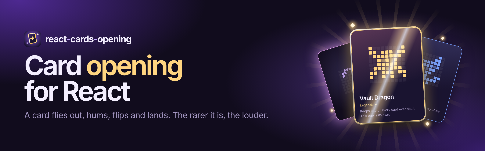
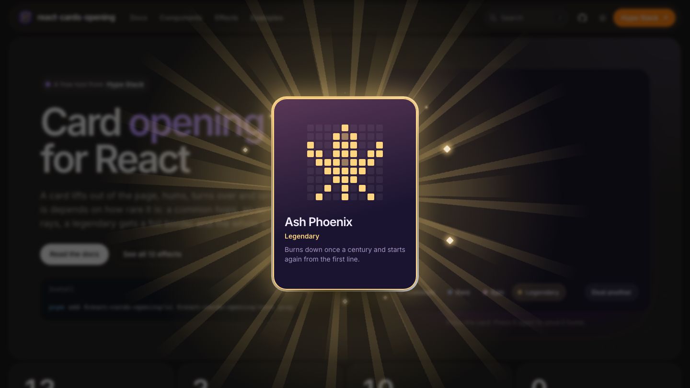
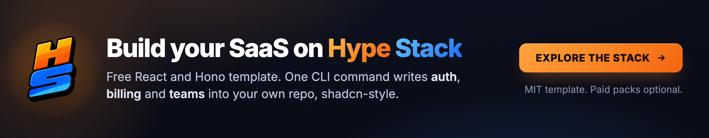
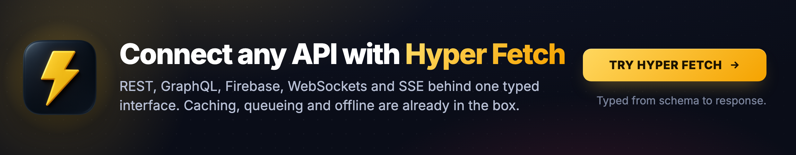

<h1 align="center">

<a href="https://bettertyped.github.io/react-cards-opening/">
  
</a>

</h1>

<div align="center">

**Card opening for React. A free tool from
[Hype Stack](https://www.hype-stack.dev/?utm_source=react-cards-opening&utm_medium=referral&utm_campaign=readme-top).**

**[Docs](https://bettertyped.github.io/react-cards-opening/) |
[Effects](https://bettertyped.github.io/react-cards-opening/docs/effects/) |
[Examples](https://bettertyped.github.io/react-cards-opening/docs/examples/) |
[Discord](https://www.hype-stack.dev/discord)**

</div>

<div align="center">
  <a href="https://bettertyped.com/">
    
  </a>
  <a href="https://www.npmjs.com/package/@react-cards-opening/ui">
    
  </a>
  <a href="https://github.com/BetterTyped/react-cards-opening">
    
  </a>
  <a href="https://github.com/BetterTyped/react-cards-opening/blob/main/LICENSE.md">
    
  </a>
  <a href="https://www.npmjs.com/package/@react-cards-opening/ui">
    
  </a>
  <a href="https://bundlephobia.com/package/@react-cards-opening/ui">
    
  </a>
  <a href="https://github.com/BetterTyped/react-cards-opening">
    
  </a>
  <a href="https://x.com/maciej_pyrc">
    
  </a>
</div>

<br />

<p align="center">
  <a href="https://www.hype-stack.dev/discord">
    
  </a>
</p>

<br />

## What it is

react-cards-opening is the moment a card is opened, as a library. A card lifts out of wherever it was, flies to the
middle of the screen face down, hums, turns over, stays as long as it takes to read, and lands where it belongs.

How it arrives depends on how rare it is. Six tiers ship (common, uncommon, rare, epic, legendary, mythic) and each has
a show of its own: a common is set down in a puff of dust, a rare arrives in ice, an epic over a turning sigil, a
legendary in a pillar of light, and a mythic puts the lights out and arrives in an impact frame with the air cracking
around it.

There are four ways to get to that moment: a sealed **pack** that bursts and deals its cards face down, a **reel** that
races under a marker and stops on your card, a **case** that opens and gives its cards up one by one, and a **hunt**
that scans a grid for them. On top sits a library of 64 effects (particles, light, shockwaves, screen effects) to play
on any of them, or on anything else.

It was built for the year in review inside
[Hype Stack](https://www.hype-stack.dev/wrapped?utm_source=react-cards-opening&utm_medium=referral&utm_campaign=readme),
where it turns achievements into cards. The reveal started there; the pack, the reel, the case, the six tiers and the
effects grew here.

<p align="center">
  <a href="https://bettertyped.github.io/react-cards-opening/">
    
  </a>
</p>

## Install

```bash
pnpm add @react-cards-opening/ui @react-cards-opening/core gsap
```

Load the stylesheet once, anywhere in your app:

```tsx
import "@react-cards-opening/ui/styles.css";
```

You need React 18 or 19 and GSAP 3.13 or newer. Every class in the stylesheet starts with `rco-` and it only styles what
the library renders, so there is no Tailwind to set up, no reset to load, and nothing leaks into your page.

## Quick start

Describe the cards, keep track of which are opened, and give them somewhere to hide.

```tsx
import { useOpenedCards } from "@react-cards-opening/core";
import { CardHunt, GLYPHS, themeOf, type GlyphCard } from "@react-cards-opening/ui";
import "@react-cards-opening/ui/styles.css";

const cards: GlyphCard[] = [
  { id: "lantern-fox", rarity: "rare", name: "Lantern Fox", line: "Knows a shortcut.", art: GLYPHS.fox },
  { id: "ember-cat", rarity: "epic", name: "Ember Cat", line: "Sleeps on warm machines.", art: GLYPHS.cat },
  {
    id: "vault-dragon",
    rarity: "legendary",
    name: "Vault Dragon",
    line: "Keeps one of every card.",
    art: GLYPHS.dragon,
  },
];

// The grid the cards hide in: one number per cell, 0 (unlit) to 4. Use your own data.
const levels = Array.from({ length: 30 * 7 }, (_unused, day) => [0, 1, 2, 0, 3, 2, 4, 1, 0, 2][(day * 7) % 10]);

export function Hunt() {
  // Remembered on this device, under a key that changes with the deal.
  const { opened, open } = useOpenedCards("deal:ada:2026");
  return <CardHunt cards={cards} opened={opened} onOpen={open} levels={levels} theme={themeOf("grape", "dark")} />;
}
```

That is the whole hunt: a grid, a scan button, the reveal for each card found, and a list of finds that can be opened
again. [Your first opening](https://bettertyped.github.io/react-cards-opening/docs/first-opening/) builds it up from one
card and one button.

<p align="center">
	<a href="https://github.com/sponsors/prc5?tier=Platinum">
		<picture>
			
		</picture>
	</a>
</p>

<p align="center">
	<a href="https://github.com/sponsors/prc5?tier=Platinum">
		<picture>
			
		</picture>
	</a>
</p>

## Packages

Two packages, released together under one version number. A pair with the same version always fits.

| Package                                                                                         | What it holds                                                                                                                                               |
| ----------------------------------------------------------------------------------------------- | ----------------------------------------------------------------------------------------------------------------------------------------------------------- |
| [`@react-cards-opening/core`](https://bettertyped.github.io/react-cards-opening/docs/core/)     | The rules without a look: the queue, a pack's stages, what each press means, rarity tiers, seeded rolls, opened-card storage. React is its only dependency. |
| [`@react-cards-opening/ui`](https://bettertyped.github.io/react-cards-opening/docs/components/) | The look: the pack, the reel, the case and the hunt, the reveal they share, 64 effects, ten themes, one stylesheet. GSAP inside.                            |

## What is in it

| Part                               | What it does                                                                                                                                       | Docs                                                                                           |
| ---------------------------------- | -------------------------------------------------------------------------------------------------------------------------------------------------- | ---------------------------------------------------------------------------------------------- |
| `CardPack`                         | A sealed pack. It bursts on a press, deals its cards face down, and each one turns over on a press, in any order                                   | [CardPack](https://bettertyped.github.io/react-cards-opening/docs/components/card-pack/)       |
| `CardSpin`                         | A reel that races under a marker and stops on the card that was dealt. The strip is filled by the real odds                                        | [CardSpin](https://bettertyped.github.io/react-cards-opening/docs/components/card-spin/)       |
| `CardCase`                         | A case that shakes, opens, and gives up its cards one after another onto a shelf                                                                   | [CardCase](https://bettertyped.github.io/react-cards-opening/docs/components/card-case/)       |
| `CardHunt`                         | A grid with cards hidden in it, the scan that finds them, and the list of finds, in one component                                                  | [CardHunt](https://bettertyped.github.io/react-cards-opening/docs/components/card-hunt/)       |
| `CardOpening`                      | The reveal they all end in. A card leaves an element you name, turns over in the middle of the screen and lands on another                         | [CardOpening](https://bettertyped.github.io/react-cards-opening/docs/components/card-opening/) |
| 64 effects                         | Sparks, confetti, embers, fireworks, rays, lens flares, lightning, shockwaves, novas, screen shake, glitch and more. One name each, and they stack | [Effects library](https://bettertyped.github.io/react-cards-opening/docs/effects/library/)     |
| `effects`                          | A plan on any opener: which tier plays which effects as its card turns. Six ready-made sets, or your own                                           | [Effect plans](https://bettertyped.github.io/react-cards-opening/docs/effects/plans/)          |
| `EffectLayer`                      | A sheet to play any effect on anything: a level-up, a purchase, a streak                                                                           | [EffectLayer](https://bettertyped.github.io/react-cards-opening/docs/components/effect-layer/) |
| `Card`                             | A card standing still, at any size, for a collection or a shop. A legendary keeps its foil on CSS alone                                            | [Card](https://bettertyped.github.io/react-cards-opening/docs/components/card/)                |
| `ScanGrid`, `SpinReel`, `LootCase` | The grid, the reel and the case on their own, for a layout that is yours                                                                           | [Components](https://bettertyped.github.io/react-cards-opening/docs/components/)               |
| `useCardOpening`, `useCardPack`    | The rules with nothing drawn: the queue, a pack's stages, what each press means. Build your own look on them                                       | [Core](https://bettertyped.github.io/react-cards-opening/docs/core/)                           |
| `rollCards`                        | Deals cards by rarity weight. With a seed, the same hand on a server and in a browser                                                              | [Rolls and odds](https://bettertyped.github.io/react-cards-opening/docs/core/rolls/)           |
| `classNames`                       | A class of your own on any part. Tailwind utilities or plain CSS, no `!important`                                                                  | [Styling by hand](https://bettertyped.github.io/react-cards-opening/docs/guides/styling/)      |
| Ten themes                         | Each in dark and light, or a whole theme from one accent colour                                                                                    | [Theming](https://bettertyped.github.io/react-cards-opening/docs/theming/)                     |

<p align="center">
	<a href="https://github.com/sponsors/prc5?tier=Gold">
		<picture>
			
		</picture>
	</a>
</p>

<p align="center">
	<a href="https://github.com/sponsors/prc5?tier=Gold">
		<picture>
			
		</picture>
	</a>
</p>

## Recipes

### A pack, with effects

A sealed pack of five and a plan that says what each tier plays as its card turns.

```tsx
import { useOpenedCards } from "@react-cards-opening/core";
import { CardPack, EFFECT_SETS } from "@react-cards-opening/ui";

export function Pack({ cards }: { cards: GlyphCard[] }) {
  const { opened, open } = useOpenedCards("pack:42");
  return <CardPack cards={cards} opened={opened} onOpen={open} effects={EFFECT_SETS.radiant} />;
}
```

Swap `CardPack` for `CardSpin` or `CardCase` and the same cards open on a reel or out of a case.

### An effect on anything

```tsx
import { EffectLayer, type EffectLayerHandle } from "@react-cards-opening/ui";

const layer = useRef<EffectLayerHandle>(null);

<div style={{ position: "relative" }}>
  <EffectLayer handle={layer} />
  <button onClick={(event) => layer.current?.play(["shockwave", "confetti"], { at: event.currentTarget })}>
    Claim
  </button>
</div>;
```

### Open a card from a button

`CardOpening` on its own, with a button to leave from. This is the shape of a daily reward or a loot drop.

```tsx
import { rollCards, useCardOpening } from "@react-cards-opening/core";
import { CardOpening } from "@react-cards-opening/ui";
import { useRef, useState } from "react";

export function DailyCard({ userId, today }: { userId: string; today: string }) {
  const button = useRef<HTMLButtonElement>(null);
  // The same person gets the same card all day, on any device.
  const [cards] = useState(() => rollCards({ pool, count: 1, seed: `${userId}:${today}` }));
  const [opened, setOpened] = useState<string[]>([]);
  const hunt = useCardOpening({ cards, opened, onOpen: (id) => setOpened((now) => [...now, id]) });

  return (
    <>
      <button ref={button} onClick={() => hunt.start()} disabled={hunt.running || hunt.allOpened}>
        Open today's card
      </button>
      <CardOpening opening={hunt.opening} launch={() => button.current} />
    </>
  );
}
```

### Tiers of your own

A tier says how often it comes up and how loud its reveal is. The theme says what colour it wears.

```tsx
import type { RarityTier } from "@react-cards-opening/core";
import { themeOf } from "@react-cards-opening/ui";

const tiers: RarityTier[] = [
  { id: "bronze", label: "Bronze", weight: 70, effect: "quiet" },
  { id: "silver", label: "Silver", weight: 25, effect: "loud" },
  { id: "gold", label: "Gold", weight: 5, effect: "legendary" },
];
const theme = { ...themeOf("mono", "dark"), rarity: { bronze: "#d08a5a", silver: "#c3ccd6", gold: "#f2cc60" } };

<CardHunt rarities={tiers} theme={theme} {...rest} />;
```

### Style it by hand

Every part takes a class of your own through `classNames`, and every rule in the stylesheet weighs one class, so yours
wins. With Tailwind 4, import the stylesheet into the `components` layer and utilities work on any part.

```css
@import "tailwindcss";
@import "@react-cards-opening/ui/styles.css" layer(components);
```

```tsx
<CardHunt
  classNames={{
    root: "rounded-none bg-zinc-950 p-10",
    headline: "font-serif text-5xl",
    scanButton: "rounded-md bg-pink-500 px-8 text-white",
    face: "rounded-xl p-4",
  }}
  {...rest}
/>
```

Plain CSS works the same way: `.my-hunt .rco-hunt-headline { ... }`. The parts, the states and the variables are listed
in [Styling by hand](https://bettertyped.github.io/react-cards-opening/docs/guides/styling/).

### Only the rules

`core` on its own has no GSAP and no stylesheet. It answers what a press means and when a card counts as opened, and you
draw the rest. [Your own UI on core](https://bettertyped.github.io/react-cards-opening/docs/guides/own-ui-on-core/)
builds a reveal from a `div` and CSS.

```tsx
const hunt = useCardOpening({ cards, opened, onOpen });

hunt.start(); // open every unopened card, one after another
hunt.pressCard(); // face down: turn it. face up: send it home
hunt.pressBackdrop(); // stop. a turned card still lands
hunt.openAll(); // skip the show
```

<p align="center">
	<a href="https://github.com/sponsors/prc5?tier=Silver">
		<picture>
			
		</picture>
	</a>
</p>

<p align="center">
	<a href="https://github.com/sponsors/prc5?tier=Silver">
		<picture>
			
		</picture>
	</a>
</p>

## Try other BetterTyped projects

react-cards-opening is cut from Hype Stack, the full-stack template I build. Here is what else I maintain.

<p align="center">
  <a href="https://www.hype-stack.dev/?utm_source=react-cards-opening&utm_medium=referral&utm_campaign=readme">
    
  </a>
</p>

<p align="center">
  <a href="https://github.com/BetterTyped/hyper-fetch">
    
  </a>
</p>

<p align="center">
  <a href="https://github.com/BetterTyped/react-zoom-pan-pinch">
    
  </a>
</p>

## Development

```bash
pnpm install
pnpm build
pnpm typecheck
pnpm lint
pnpm test
```

Node 24, pnpm 12, Nx, Vite 8, tsgo, oxlint and oxfmt. Commits follow conventional commits, because the next version
number is worked out from them. [UPSTREAM.md](./UPSTREAM.md) says where the code came from and how it is kept in step.

The look is guarded by a picture test: `apps/playground` plays the library frame by frame and compares every frame with
a stored one.

```bash
pnpm --filter @react-cards-opening/playground e2e
```

## Our sponsors

<p align="center">
	<a href="https://github.com/sponsors/prc5">
		
	</a>
</p>

## GSAP

GSAP is a peer dependency of `@react-cards-opening/ui`. You install it yourself and it comes under its own license,
which is free to use, commercial projects included, but is not MIT. Read the
[GSAP standard license](https://gsap.com/community/standard-license/) before you ship. `@react-cards-opening/core` does
not use it.

## License

[MIT](./LICENSE.md)
